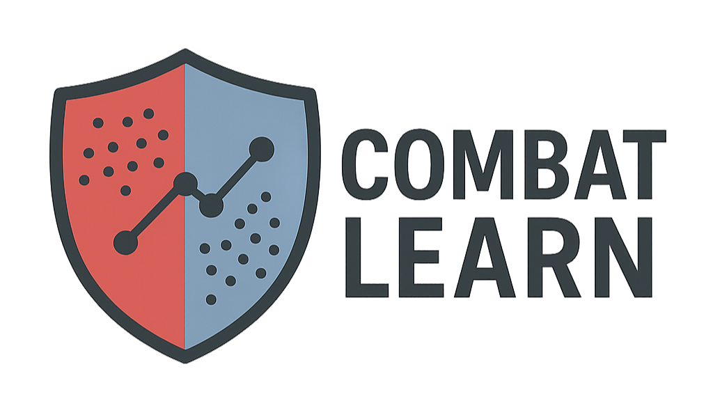

# **combatlearn**

[](https://www.python.org/)
[](https://github.com/EttoreRocchi/combatlearn/actions/workflows/test.yaml)
[](https://combatlearn.readthedocs.io)
[](https://pypi.org/project/combatlearn/)
[](https://github.com/EttoreRocchi/combatlearn/blob/main/LICENSE)

<div align="center">
<p></p>
</div>

**combatlearn** makes the popular _ComBat_ (and _CovBat_) batch-effect correction algorithm available for use into machine learning frameworks. It lets you harmonise high-dimensional data inside a scikit-learn `Pipeline`, so that cross-validation and grid-search automatically take batch structure into account, **without data leakage**.

**Inductive `ComBat` methods** (fit on train, apply to held-out data, cross-validation-safe):
- `method="johnson"` - classic ComBat (Johnson _et al._, 2007)
- `method="fortin"` - neuroComBat (Fortin _et al._, 2018)
- `method="chen"` - CovBat (Chen _et al._, 2022)
- `method="gam"` - ComBat-GAM, nonlinear (spline) covariate effects (Pomponio _et al._, 2020)
- `method="covbat_gam"` - CovBat with the same nonlinear covariate modeling

**Inductive estimators with their own signature** (same fit/transform contract, separate classes):
- `NestedComBat` - harmonizes over several batch variables at once (e.g. site, scanner, protocol) with optional order optimization and Gaussian-mixture grouping (Nested / OPNested / GMM ComBat, Horng _et al._, 2022)
- `LongitudinalComBat` - repeated-measures / longitudinal designs with a per-subject random intercept (Beer _et al._, 2020). Inductive under a stricter precondition than `ComBat`: the batch **and** the subject must have been seen at fit; unseen subjects degrade to the population correction, or raise with `on_unseen_subject="error"`
- `GLMComBat` - non-Gaussian data via a parametric GLM plus a strictly per-observation quantile map:
  - `method="seq"` - ComBat-seq for raw RNA-seq counts, negative-binomial with a library-size offset (Zhang _et al._, 2020). Integer in, integer out
  - `method="met"` - ComBat-met for DNA-methylation beta-values, beta regression with a logit link (Wang, 2025). Output stays strictly inside `(0, 1)`
  - Both are **cross-validation-safe**, which no published implementation of either method offers: upstream they are whole-cohort functions

**Whole-cohort (transductive)** - `combatlearn.transductive.TransductiveComBat` holds configurations that cannot be frozen at fit, namely those protecting a condition-of-interest / outcome term in the design, used as a one-shot `fit_transform`. Its principal occupants are `method="seq"` and `method="met"`, the condition-protected ComBat-seq / ComBat-met variants for differential expression and differential methylation. `method="longitudinal"` is deprecated in favor of `LongitudinalComBat`, as is `ComBat(method="longitudinal")`; both are removed in v3.0.0.

## Installation

```bash
pip install combatlearn
```

## Documentation

**Full documentation is available at [combatlearn.readthedocs.io](https://combatlearn.readthedocs.io)**

The documentation includes:
- [Methods Guide](https://combatlearn.readthedocs.io/en/latest/methods.html)
- [API Reference](https://combatlearn.readthedocs.io/en/latest/api.html)

## Quick start

```python
import pandas as pd
from sklearn.pipeline import Pipeline
from sklearn.preprocessing import StandardScaler
from sklearn.linear_model import LogisticRegression
from sklearn.model_selection import GridSearchCV
from combatlearn import ComBat

df = pd.read_csv("data.csv", index_col=0)
X, y = df.drop(columns="y"), df["y"]

batch = pd.read_csv("batch.csv", index_col=0).squeeze("columns")
diag = pd.read_csv("diagnosis.csv", index_col=0) # categorical
age = pd.read_csv("age.csv", index_col=0) # continuous

pipe = Pipeline([
    ("combat", ComBat(
        batch=batch,
        discrete_covariates=diag,
        continuous_covariates=age,
        method="fortin", # or "johnson" or "chen"
        parametric=True
    )),
    ("scaler", StandardScaler()),
    ("clf", LogisticRegression())
])

param_grid = {
    "combat__mean_only": [True, False],
    "clf__C": [0.01, 0.1, 1, 10],
}

grid = GridSearchCV(
    estimator=pipe,
    param_grid=param_grid,
    cv=5,
    scoring="roc_auc",
)

grid.fit(X, y)

print("Best parameters:", grid.best_params_)
print(f"Best CV AUROC: {grid.best_score_:.3f}")
```

For a full example of how to use **combatlearn** see the [notebook demo](https://github.com/EttoreRocchi/combatlearn/blob/main/docs/source/demo/combatlearn_demo.ipynb)

## Multiple batch variables (`NestedComBat`)

When more than one technical variable needs harmonizing, `NestedComBat` applies ComBat to each in sequence. It picks the harmonization order that minimizes the residual batch effect, and can optionally add a latent Gaussian-mixture grouping. It is inductive and fits inside a `Pipeline` just like `ComBat`.

```python
import pandas as pd
from combatlearn import NestedComBat

batch = pd.DataFrame({"site": site, "scanner": scanner})  # one column per batch variable

nested = NestedComBat(
    batch=batch,
    continuous_covariates=age,
    discrete_covariates=diag,
    method="fortin",      # per-step engine: "fortin"/"chen"/"gam"/"covbat_gam"
    optimize_order=True,  # choose the order (OPNested)
    gmm=None,             # or "batch" (+GMM) / "covariate" (-GMM)
)
X_corrected = nested.fit_transform(X)
print("Harmonization order:", nested.order_)
```

## Counts and proportions (`GLMComBat`)

RNA-seq counts and methylation beta-values are not Gaussian, and standardizing them destroys the structure downstream tools rely on. `GLMComBat` fits a negative-binomial GLM (`method="seq"`) or a beta regression (`method="met"`) and then maps each observation through the CDF of its own batch's fitted distribution into the corresponding quantile of a batch-free one.

That quantile map is **strictly per observation** - it uses only the sample's own measurements, batch label, covariates and (for `"seq"`) library size - so the model freezes at `fit` and `transform` applies to held-out data. The published ComBat-seq and ComBat-met implementations are whole-cohort functions with no such split.

```python
from combatlearn import GLMComBat

harmonizer = GLMComBat(
    batch=batch,
    method="seq",                 # raw integer counts; "met" for 0-1 beta-values
    discrete_covariates=tissue,   # ordinary covariates, preserved
    reference_batch="site_A",     # recommended under cross-validation
)

counts_corrected = harmonizer.fit_transform(counts)   # reproduces the reference exactly

harmonizer.fit(counts_train)                          # ... or freeze and reuse
counts_test_corrected = harmonizer.transform(counts_test)
```

`fit_transform` on a whole cohort is verified bit-exact against InMoose `pycombat_seq`, and to within 1e-6 against committed fixtures from the ComBat-met R package. The **inductive** path has no external reference to compare with - it is validated by its defining property, that a held-out sample is corrected identically alone or in company.

If the term you want to protect *is* the supervised target of a differential analysis on the same cohort, use `TransductiveComBat(method="seq"/"met", condition=...)` instead; if it is known at intake, it is an ordinary covariate and belongs here.

## Repeated measures (`LongitudinalComBat`)

When the same subjects are measured more than once, `LongitudinalComBat` adds a per-subject random intercept (REML) to the Fortin model, so within-subject correlation is modeled rather than treated as noise. It keeps the `fit`/`transform` contract, so a frozen correction can be applied to later visits of subjects already in the reference cohort.

```python
from combatlearn import LongitudinalComBat

harmonizer = LongitudinalComBat(
    batch=batch,
    subject_id=subject,        # required: one label per sample
    time_covariate=visit,      # optional: continuous time variable
    continuous_covariates=age,
)

X_corrected = harmonizer.fit_transform(X)          # whole cohort in one pass
X_new = harmonizer.fit(X_ref).transform(X_visits)  # or freeze and apply
```

Its precondition is one step stricter than `ComBat`'s: `ComBat` needs the *batch* to have been seen at fit, `LongitudinalComBat` needs the *batch and the subject*. A subject unseen at fit degrades to the population correction (zero random intercept), or raises with `on_unseen_subject="error"`. The transform is leakage-free in every split - each subject's intercept is estimated from that subject's training visits only - but for cross-validated prediction on *genuinely new* subjects there is no advantage over `method="fortin"`; the payoff is incremental harmonization of returning subjects.

## `ComBat` parameters

The following section provides a detailed explanation of all parameters available in the scikit-learn-compatible `ComBat` class. For complete API documentation, see the [API Reference](https://combatlearn.readthedocs.io/en/latest/api/).

### Main Parameters

| Parameter | Type | Default | Description |
| --- | ---  | --- | --- |
| `batch` | array-like or pd.Series | **required** | Vector indicating batch assignment for each sample. This is used to estimate and remove batch effects. |
| `discrete_covariates` | array-like, pd.Series, or pd.DataFrame | `None` | Optional categorical covariates (e.g., sex, site). Only used in `"fortin"`, `"chen"`, `"longitudinal"`, `"gam"`, and `"covbat_gam"` methods. |
| `continuous_covariates` | array-like, pd.Series or pd.DataFrame | `None` | Optional continuous covariates (e.g., age). Only used in `"fortin"`, `"chen"`, `"longitudinal"`, `"gam"`, and `"covbat_gam"` methods. **Required** for the GAM methods. |
| `subject_id` | array-like or pd.Series | `None` | Subject/individual labels for the random intercept. **Required** for `method="longitudinal"`, ignored otherwise. |
| `time_covariate` | array-like or pd.Series | `None` | Optional continuous time variable for repeated measures. Only used in `"longitudinal"`. |

### Algorithm Options

| Parameter | Type | Default | Description |
| --- | --- | --- | --- |
| `method` | str | `"johnson"` | ComBat method to use: <ul><li>`"johnson"` - Classical ComBat (_Johnson et al. 2007_)</li><li>`"fortin"` - ComBat with covariates (_Fortin et al. 2018_)</li><li>`"chen"` - CovBat, PCA-based correction (_Chen et al. 2022_)</li><li>`"longitudinal"` - Longitudinal ComBat with a per-subject random intercept (_Beer et al. 2020_); **deprecated**, use `combatlearn.LongitudinalComBat`</li><li>`"gam"` - ComBat-GAM, nonlinear (spline) covariates (_Pomponio et al. 2020_)</li><li>`"covbat_gam"` - CovBat with the same nonlinear covariate modeling</li></ul> Case- and separator-insensitive literature aliases are also accepted (e.g. `"covbat"`, `"neurocombat"`, `"combat_gam"`). |
| `parametric` | bool | `True` | Whether to use the **parametric empirical Bayes** formulation. If `False`, the non-parametric estimate of `sva::ComBat` (`int.eprior`) is used, whose cost grows with the square of the number of features. |
| `mean_only` | bool | `False` | If `True`, only the **mean** is corrected, while variances are left unchanged. Useful for preserving variance structure in the data. For `"chen"` and `"covbat_gam"` it applies to the ComBat step only; the covariance step still harmonizes the PC-score variances. |
| `reference_batch` | str or `None` | `None` | If specified, acts as a reference batch - other batches will be corrected to match this one. |
| `covbat_cov_thresh` | float, int | `0.9` | For the `"chen"` and `"covbat_gam"` methods (also inside `NestedComBat`): Cumulative variance threshold in `(0, 1]` to retain PCs in PCA space (e.g., 0.9 = retain 90% explained variance). If an integer is provided, it represents the number of principal components to use. |
| `smooth_terms` | list of str or int, or `None` | `None` | For `"gam"`/`"covbat_gam"` only: continuous covariates to model nonlinearly with B-splines, by column name or integer position. `None` smooths all continuous covariates. |
| `spline_df` | int | `10` | For the GAM methods: B-spline degrees of freedom (basis functions) per smooth term. |
| `spline_degree` | int | `3` | For the GAM methods: B-spline degree (3 = cubic). |
| `smooth_term_bounds` | tuple or dict | `None` | For the GAM methods: boundary knots, as a single `(lo, hi)` for all terms or a `{term: (lo, hi)}` dict. Default uses each term's training min/max; widen to cover held-out data. |
| `eps` | float | `1e-8` | Small jitter value added to variances to prevent divide-by-zero errors during standardization. |


### Batch Effect Correction Visualization

The `plot_transformation` method allows to visualize the **ComBat** transformation effect using dimensionality reduction, showing the before/after comparison of data transformed by `ComBat` using PCA, t-SNE, or UMAP to reduce dimensions for visualization.

For further details see the [API Reference](https://combatlearn.readthedocs.io/en/latest/api/) and the [notebook demo](https://github.com/EttoreRocchi/combatlearn/blob/main/docs/source/demo/combatlearn_demo.ipynb).

### Batch Effect Metrics

The `compute_batch_metrics` method provides quantitative assessment of batch correction quality. It computes metrics including Silhouette coefficient, Davies-Bouldin index, kBET, LISI, and variance ratio for batch effect quantification, as well as k-NN preservation and distance correlation for structure preservation.

For further details see the [API Reference](https://combatlearn.readthedocs.io/en/latest/api/) and the [notebook demo](https://github.com/EttoreRocchi/combatlearn/blob/main/docs/source/demo/combatlearn_demo.ipynb).

## Contributing

Pull requests, bug reports, and feature ideas are welcome: feel free to open a PR!

## Author

[**Ettore Rocchi**](https://github.com/ettorerocchi) @ University of Bologna

[Google Scholar](https://scholar.google.com/citations?user=MKHoGnQAAAAJ) | [Scopus](https://www.scopus.com/authid/detail.uri?authorId=57220152522)


## Citation

If **combatlearn** is useful in your research, please cite the paper introducing this Python package:

> Rocchi, E., Nicitra, E., Calvo, M. et al. Combining mass spectrometry and machine learning models for predicting Klebsiella pneumoniae antimicrobial resistance: a multicenter experience from clinical isolates in Italy. BMC Microbiol (2026). https://doi.org/10.1186/s12866-025-04657-2

```bibtex
@article{Rocchi2026,
  author    = {Rocchi, Ettore and Nicitra, Emanuele and Calvo, Maddalena and Cento, Valeria and Peiretti, Laura and Asif, Zian and Menchinelli, Giulia and Posteraro, Brunella and Sala, Claudia and Colosimo, Claudia and Cricca, Monica and Sambri, Vittorio and Sanguinetti, Maurizio and Castellani, Gastone and Stefani, Stefania},
  title     = {Combining mass spectrometry and machine learning models for predicting Klebsiella pneumoniae antimicrobial resistance: a multicenter experience from clinical isolates in Italy},
  journal   = {BMC Microbiology},
  year      = {2026},
  doi       = {10.1186/s12866-025-04657-2},
  url       = {https://doi.org/10.1186/s12866-025-04657-2}
}
```

## Acknowledgements

This project builds on the excellent work of the ComBat family of harmonisation methods.
Please consider citing the original papers:

- [**ComBat**](https://rdrr.io/bioc/sva/man/ComBat.html) - Johnson WE, Li C, Rabinovic A. _Biostatistics_. 2007. doi: [10.1093/biostatistics/kxj037](https://doi.org/10.1093/biostatistics/kxj037)

- [**neuroCombat**](https://github.com/Jfortin1/neuroCombat) - Fortin JP et al. _Neuroimage_. 2018. doi: [10.1016/j.neuroimage.2017.11.024](https://doi.org/10.1016/j.neuroimage.2017.11.024)

- [**CovBat**](https://github.com/andy1764/CovBat_Harmonization) - Chen AA et al. _Hum Brain Mapp_. 2022. doi: [10.1002/hbm.25688](https://doi.org/10.1002/hbm.25688)

- [**Longitudinal ComBat**](https://github.com/jcbeer/longCombat) - Beer JC et al. _Neuroimage_. 2020. doi: [10.1016/j.neuroimage.2020.117129](https://doi.org/10.1016/j.neuroimage.2020.117129)

- [**ComBat-GAM**](https://github.com/rpomponio/neuroHarmonize) - Pomponio R et al. _Neuroimage_. 2020. doi: [10.1016/j.neuroimage.2019.116450](https://doi.org/10.1016/j.neuroimage.2019.116450)

- [**ComBat-seq**](https://github.com/zhangyuqing/ComBat-seq) - Zhang Y, Parmigiani G, Johnson WE. _NAR Genom Bioinform_. 2020. doi: [10.1093/nargab/lqaa078](https://doi.org/10.1093/nargab/lqaa078)

- [**ComBat-met**](https://github.com/JmWangBio/ComBatMet) - Wang J. _NAR Genom Bioinform_. 2025. doi: [10.1093/nargab/lqaf062](https://doi.org/10.1093/nargab/lqaf062)